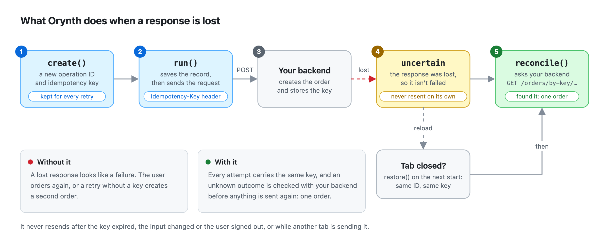

<h1 align="center">
  <picture>
    <source media="(prefers-color-scheme: dark)" srcset="docs/images/logo-dark.png">
    
  </picture>
</h1>

<p align="center"><strong>Recover interrupted writes in JavaScript and TypeScript.</strong></p>

<p align="center">
  <a href="#try-the-checkout">Checkout demo</a> ·
  <a href="#use-it-in-your-app">Quick start</a> ·
  <a href="docs/api.md">API reference</a>
</p>

## Did the order go through?

A customer places an order. Your server saves it. The connection drops before the receipt reaches the browser. What should the checkout show when the customer returns?

Orynth gives the checkout a stable identity. With IndexedDB enabled, the browser remembers the interrupted operation across reloads. Your app can ask the server for the original receipt before it offers to place the order again.

<p align="center">
  <picture>
    <source media="(prefers-color-scheme: dark)" srcset="docs/images/what-it-does-dark.png">
    
  </picture>
</p>

## Try the checkout

From a clone of this repository with Node.js 22.18 or later, run these commands.

```sh
npm ci
npm run demo:checkout
```

1. Open the [local checkout](http://127.0.0.1:4173). Leave **Drop the confirmation after saving** checked and choose **Place order**.
2. Compare the two panels. The customer is waiting for confirmation. The server ledger shows one saved order.
3. Reload and choose **Check order status**. The original receipt appears. The ledger still shows one order.

The demo uses a real SQLite database and closes the connection after the order commits. [Explore the browser client and server](examples/checkout/README.md).

## Use it in your app

```sh
npm install orynth
```

Orynth has no runtime dependencies. It works with your existing HTTP client and ships TypeScript declarations for both ESM and CommonJS. The library supports Node.js 20+ and modern browsers.

Define a write and a way to look up its outcome. This browser example uses Axios with a timeout. The demo uses native `fetch`. [HTTP client examples](docs/http-clients.md).

```ts
import axios from "axios";
import { createOrynth, OperationUncertainError, type ReconcileResult } from "orynth";
import { indexedDBStorage } from "orynth/storage";

type Items = { quantity: number };
type Order = Items & { id: number };

const api = axios.create({ baseURL: "/api", timeout: 8_000 });
const orynth = createOrynth({ storage: indexedDBStorage() });

const orders = orynth.define<Items, Order>({
  name: "checkout",
  async execute({ input, headers }) {
    const { data } = await api.post<Order>("/orders", input, { headers });
    return data;
  },
  async reconcile({ idempotencyKey }) {
    const { data } = await api.get<ReconcileResult<Order>>("/outcome", {
      params: { key: idempotencyKey },
    });
    return data;
  },
});
```

Restore outstanding checkouts at startup. In the submit handler, use a checkout ID that survives a reload. Two clicks on the same checkout then share an operation. A deliberate second purchase gets a fresh ID.

```ts
const restored = orders.restore();

async function placeOrder(checkoutId: string, items: Items): Promise<ReconcileResult<Order>> {
  await restored;
  const order = orders.get(checkoutId) ??
    orders.create(items, { id: checkoutId, idempotencyKey: checkoutId });

  try {
    return { status: "succeeded", result: await order.run() };
  } catch (error) {
    if (error instanceof OperationUncertainError) return order.reconcile();
    throw error;
  }
}
```

Show the receipt on `succeeded`. If the lookup returns `pending`, `unknown`, or `not-found`, keep the checkout available for another status check. [Handling uncertain outcomes](docs/outcomes.md).

## What your backend provides

- **A receipt for each key.** Save the idempotency key alongside the order in the same transaction. A repeat request from the same customer with the same key and input should return that order.
- **A status lookup.** Let the authenticated customer look up the outcome by key. Orynth calls this endpoint through your `reconcile` function.
- **A retention window.** Set Orynth’s `ttl` within the time your server retains keys. Automatic retries are off by default. [Retry policy](docs/retries.md) · [Backend requirements](docs/limitations.md).

## Field guide

| When you need to… | Read |
| --- | --- |
| Handle double clicks or subscribe to state changes | [Operations](docs/operations.md) |
| Recover after a reload or isolate users on a shared device | [Persistence and account scopes](docs/persistence.md) |
| Coordinate a checkout across browser tabs | [Web Locks and leases](docs/multiple-tabs.md) |
| Decide whether a retry library is enough | [Comparison with retry libraries](docs/retry-libraries.md) |
| Look up an option, type, or error | [API reference](docs/api.md) |

[Contributing](CONTRIBUTING.md) · [Changelog](CHANGELOG.md) · [MIT license](LICENSE)
