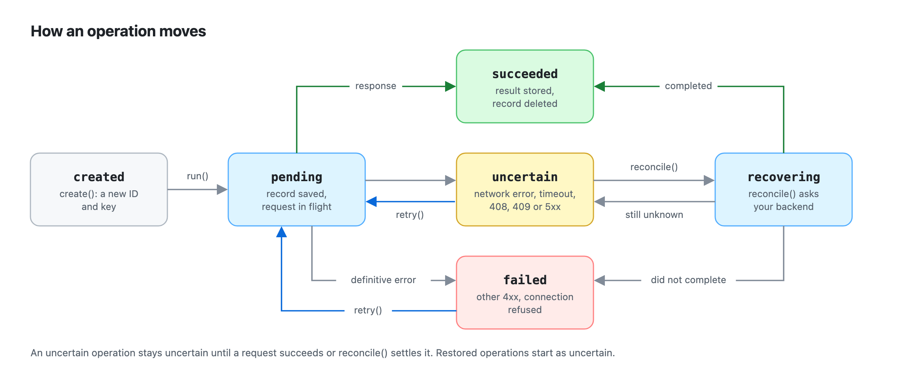

# Operations

Creating and running operations, their states, and what happens when the same operation is called twice or the user clicks twice.

## Running operations

`define()` describes a kind of mutation once. `create()` starts a new logical operation, and `run()` executes it:

```ts
const operation = createOrder.create(input); // new ID, new idempotency key
operation.id; // "4f9c…"
operation.idempotencyKey; // "b1e2…" — random, never derived from the input
operation.status; // "created"

const order = await operation.run();
operation.status; // "succeeded"
operation.state.result; // the order
```

Calling `create()` twice with the same input makes two operations, because the user did two things. Use the same handle for a retry; use `create()` for a new intent.

Each operation moves through these states:

<p align="center">
  <picture>
    <source media="(prefers-color-scheme: dark)" srcset="images/lifecycle-dark.png">
    
  </picture>
</p>

Any other transition throws `InvalidTransitionError`. Both the transitions and `run()` depend on the current state:

| State | `run()` | `retry()` | `reconcile()` |
| --- | --- | --- | --- |
| `created` | executes | executes | throws `InvalidTransitionError` |
| `pending` / `recovering` | [concurrency strategy](#duplicate-execution-prevention) | concurrency strategy | joins a reconciliation; rejects during a request |
| `succeeded` | returns the stored result | returns the stored result | returns `{ status: "succeeded", result }` |
| `failed` | rejects with the stored error | executes again, [if safe](retries.md#when-orynth-refuses-to-resend) | returns `{ status: "failed", error }` |
| `uncertain` | rejects with `OperationUncertainError` | executes again, [if safe](retries.md#when-orynth-refuses-to-resend) | asks the backend |

Subscribe to state changes, for example to update UI:

```ts
const unsubscribe = operation.subscribe((state) => {
  render(state.status, state.result, state.error);
});
```

Listeners are called synchronously after every change with an immutable snapshot. A listener that throws doesn't affect the operation; the error goes to `reportError` (browsers, Deno) or `console.error` (Node). `operation.state` always returns the latest snapshot, so `subscribe` and `state` work directly with `useSyncExternalStore` and similar store APIs.

## Duplicate execution prevention

Protection is scoped to an operation, not to its payload. Two operations with identical input run independently. Calling `run()` or `retry()` on an operation that is already executing applies its `concurrency` strategy:

| Strategy | Duplicate call |
| --- | --- |
| `join` (default) | Returns the in-flight promise. Every caller gets the same result. |
| `reject` | Rejects with `OperationInProgressError`. |
| `ignore` | Resolves with `undefined` and does nothing. |
| `queue` | Waits until the current execution settles, then proceeds based on the new state. |

```ts
const submitPayment = orynth.define({ name: "submit-payment", concurrency: "reject", execute });

const payment = submitPayment.create(details);
button.onclick = () => payment.run().then(showReceipt, showError); // second click → OperationInProgressError
```

A succeeded operation never executes again, whatever the strategy: `run()` returns the stored result. `join` and `queue` callers that arrive during a `reconcile()` wait for it, so a `retry()` queued behind a reconciliation that finds the order does nothing.

## Double clicks and user intent

Protection works per operation, so a click handler that calls `create()` on every click gets none: each click starts a new operation. Mutation libraries that deduplicate nothing behave the same way. Tie the operation to the user's intent instead, such as a checkout or form ID:

```ts
const restored = createOrder.restore(); // at startup

async function placeOrder(checkoutId: string, input: OrderInput) {
  await restored; // an order left over from a reload is found, not created again
  const operation =
    createOrder.get(checkoutId) ?? // the order already being placed for this checkout
    createOrder.create(input, { id: checkoutId, idempotencyKey: checkoutId });
  return operation.run(); // a second click joins the first
}
```

`definition.get(id)` returns the operation the instance is running or tracking under that ID. An ID only protects while its operation is tracked: once the operation resolves and its record is deleted, the ID is free and `create()` with it starts a new operation. That's why the pattern also uses the intent's ID as the **idempotency key**: a click after the order succeeded sends the same key again, so an idempotent backend returns the existing order instead of creating another. When the user really wants a second order, give it a new checkout ID.

A reused key keeps the expiry of its first use in this instance, so the new operation isn't resent after the backend may have forgotten the key. If the key may have been sent in an earlier session, tell the instance when the backend forgets it, for example from when the checkout started: `create(input, { id, idempotencyKey, expiresAt: checkout.startedAt + KEY_TTL })`. (Right after an operation resolves, `create()` with its ID can briefly throw "already active"; `get()` returns the resolved operation in that window, which is why the pattern calls it first.)

## TypeScript

Annotate the execute context and the input and result types are inferred everywhere:

```ts
const createOrder = orynth.define({
  name: "create-order",
  execute: async ({ input }: ExecuteContext<OrderInput>): Promise<Order> => { /* … */ },
});

const operation = createOrder.create({ productId: "123", quantity: 2 }); // Operation<OrderInput, Order>
const order = await operation.run(); // Order
createOrder.create({ productId: "123" }); // ✗ type error: quantity is missing
```

Or pass the types explicitly: `orynth.define<OrderInput, Order>({ … })`.

- The `reconcile` function's `result` is checked against the result type.
- Operations without input (`unknown` or `void`) can be created with `create()`.
- With `concurrency: "ignore"`, `run()` returns `Promise<Result | undefined>`, because a duplicate call resolves with `undefined`. The same applies when the strategy is a variable of type `ConcurrencyStrategy`.
- `orynth.restore()` returns `Operation[]` (untyped). Use `definition.restore()` for typed operations.
- `operation.input` is `Input | undefined`, because a restored operation has no input unless it was persisted.
